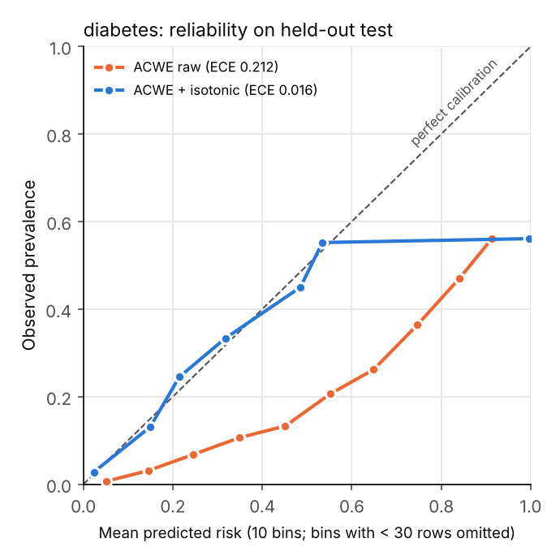
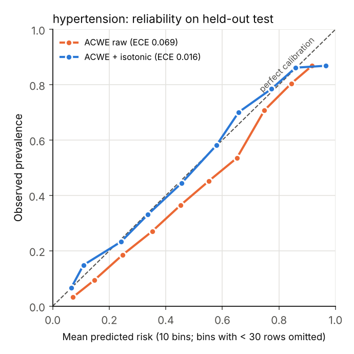
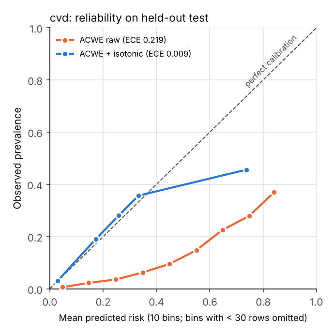
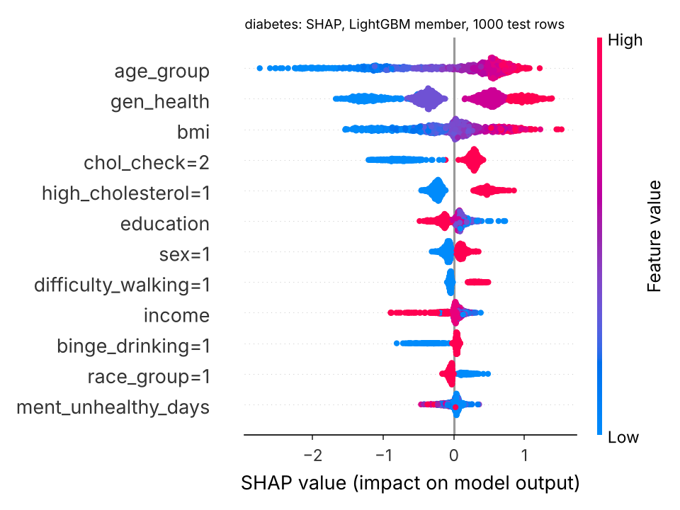
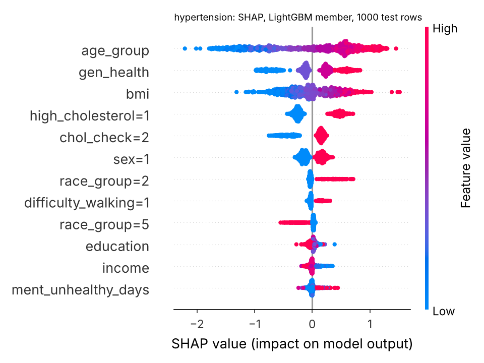
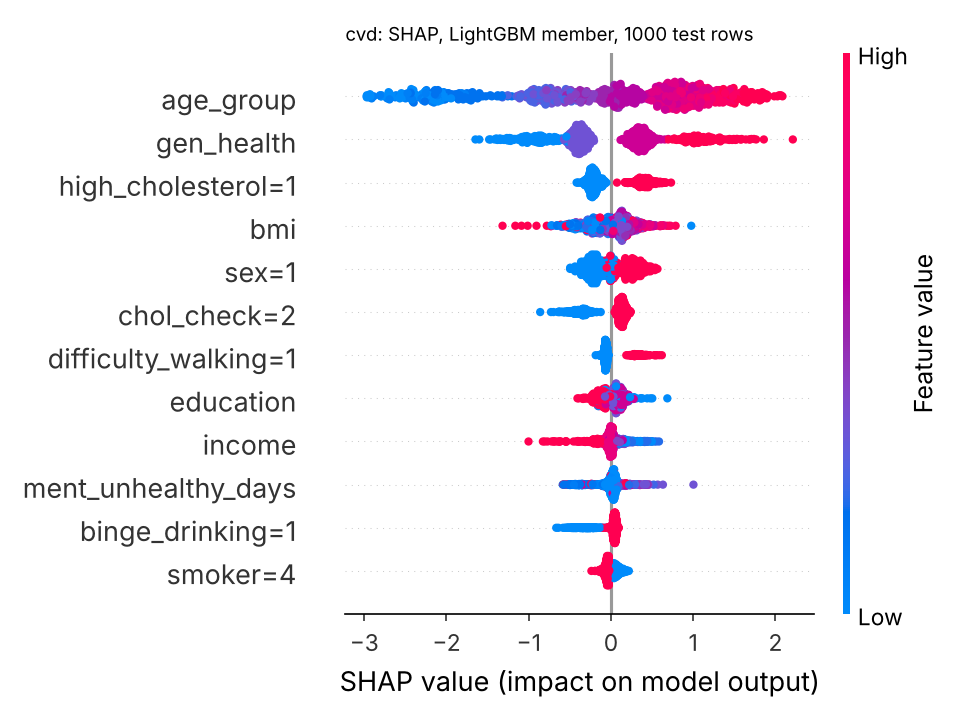

# BIO-SENTINEL

Multi-label chronic-disease **risk** modelling (type 2 diabetes, hypertension, CVD) on the CDC BRFSS 2021 public-use survey, with dynamic ensembling, isotonic calibration, split conformal prediction, SHAP, a FastAPI service and a React dashboard.

> **Research prototype.** It estimates model-based risk from self-reported survey data. It is not a diagnostic tool and must not be used for clinical decisions.

[](https://github.com/Gargikhandekar/Bio-Sentinel/actions/workflows/ci.yml)

## Key finding

**Calibration, not dynamic weighting, drives the reliability gain.** Isotonic calibration cuts the ensemble's Brier score by 39% (diabetes) and 52% (CVD) and brings ECE from as high as 0.22 down to 0.009–0.016 on all three targets. The adaptive ensemble (ACWE) does not beat a plain soft vote, and a single LightGBM with the same calibration step reaches about the same Brier and ECE. The raw models are badly calibrated mainly because they are trained with `class_weight="balanced"`, which inflates predicted risk. Calibration undoes that.

## Results

Held-out test set (8,000 rows per target, seed 42, 40k stratified subsample of the 431,843 complete-case respondents). Reproduce with `python scripts/reproduce.py`; raw numbers are in [`results/metrics/`](results/metrics/).

| Target (prevalence) | Model | ROC-AUC | PR-AUC | Brier ↓ | ECE ↓ |
| --- | --- | --- | --- | --- | --- |
| **Diabetes** (13.1%) | LightGBM | 0.817 | 0.377 | 0.165 | 0.209 |
| | LightGBM + isotonic | 0.815 | 0.360 | 0.097 | 0.015 |
| | Soft vote | 0.821 | 0.388 | 0.159 | 0.214 |
| | ACWE raw | 0.821 | 0.387 | 0.157 | 0.212 |
| | ACWE + isotonic | 0.819 | 0.362 | **0.096** | 0.016 |
| **Hypertension** (39.2%) | LightGBM | 0.806 | 0.711 | 0.180 | 0.068 |
| | LightGBM + isotonic | 0.803 | 0.691 | 0.175 | 0.020 |
| | Soft vote | 0.808 | 0.713 | 0.178 | 0.069 |
| | ACWE raw | 0.808 | 0.713 | 0.178 | 0.069 |
| | ACWE + isotonic | 0.806 | 0.696 | **0.174** | 0.016 |
| **CVD** (8.1%) | LightGBM | 0.820 | 0.273 | 0.145 | 0.213 |
| | LightGBM + isotonic | 0.815 | 0.248 | 0.067 | 0.007 |
| | Soft vote | 0.832 | 0.287 | 0.141 | 0.224 |
| | ACWE raw | 0.831 | 0.286 | 0.137 | 0.219 |
| | ACWE + isotonic | 0.826 | 0.268 | **0.066** | 0.009 |

**Split conformal prediction** (α = 0.1, calibrated ACWE scores):

| Target | Coverage (target 0.90) | Coverage, positives | Coverage, negatives | Avg set size |
| --- | --- | --- | --- | --- |
| Diabetes | 0.924 | 0.433 | 0.997 | 1.14 |
| Hypertension | 0.899 | 0.828 | 0.945 | 1.39 |
| CVD | 0.918 | 0.048 | 0.995 | 1.00 |

Marginal coverage meets the target for every disease, but that hides a problem. For CVD, nearly every prediction set is just {0}: the 90% guarantee is met largely by predicting "no CVD" for almost everyone, so positive cases are almost never covered. Class-conditional (Mondrian) conformal prediction would be the fix. See [Limitations](#limitations).

Other findings:
- **Ablation:** removing dynamic weighting or local competence changes ROC-AUC by ≤ 0.001 when every variant gets its own calibrator. For CVD, plain logistic regression (0.833) beats calibrated ACWE (paired bootstrap p = 0.004).
- **Online learning / drift:** on the simulated shifted stream, the River learners (0.826 and 0.838 prequential accuracy) do no better than a majority-class predictor (0.839), and ADWIN raises no alarm.

| Reliability (raw vs isotonic) | | |
| --- | --- | --- |
|  |  |  |

| SHAP (LightGBM member, 1,000 test rows) | | |
| --- | --- | --- |
|  |  |  |

SHAP shows association, not causation. For example, `chol_check=2` ("cholesterol checked in the past year") pushes diabetes risk up because people with a diagnosis get monitored more often.

## How it works

```
BRFSS XPT ─► complete-case parquet ─► stratified 60/20/20 split (by 3-label pattern)
   train 60%  ─► preprocessing fit + member models (LR, RF, linear SVM, LightGBM, MLP)
   valid 20%  ─► three disjoint thirds:
                   competence  ─► ACWE kNN competence + reliability weights
                   calibration ─► isotonic calibrators
                   conformal   ─► conformal quantile
   test  20%  ─► metrics only
```

- **Targets:** `DIABETE4==1`, `BPHIGH6==1`, `_MICHD==1`. Pregnancy-only and borderline answers count as negatives.
- **Leakage guardrails:** the label columns are excluded from the features, as are their skip-pattern proxies (`BPMEDS`, `DIABAGE3`) and stroke, and an automated audit (`src/data/leakage.py`) enforces this. Tests check that preprocessing statistics come from training rows only, that the holdout thirds are disjoint, and that ACWE never sees the current row's label.
- **ACWE** (adaptive context-weighted ensemble): each member's weight is local competence × recent accuracy × validation AUC, normalized to sum to 1. It combines existing dynamic-ensemble ideas and is not claimed as a new algorithm.
- **Classifier chain** and a **co-occurrence prior** test whether modelling the links between diseases helps. It doesn't.

More detail: [`research/methodology.md`](research/methodology.md), [`research/leakage_audit.md`](research/leakage_audit.md), [`INTERVIEW_NOTES.md`](INTERVIEW_NOTES.md).

## Quickstart

```bash
python -m pip install -r requirements.txt     # Python 3.11+
# data: see data/README.md (one curl + unzip)
python scripts/reproduce.py                   # ~10 min on 4 CPU cores; writes results/
uvicorn backend.main:app --port 8000          # API on :8000
cd frontend && npm ci && npm run dev          # dashboard on :5173
```

Docker: `docker compose run --rm api python scripts/reproduce.py` trains the models, then `docker compose up` serves the API (:8000) and the dashboard (:5173).

**API:** `POST /api/predict` and `POST /api/explain` take `{"label": "diabetes" | "hypertension" | "cvd", "features": {...}}` and return the calibrated risk, the conformal prediction set, the ensemble weights and a per-input SHAP explanation. Read-only endpoints: `/api/health`, `/api/models`, `/api/experiments`, `/api/drift`, `/api/research/{metrics,ablation,calibration}`.

**Tests:** `pytest`. It runs the full pipeline end to end on synthetic BRFSS-shaped data in a temp directory, plus unit tests and API tests. CI runs pytest, the frontend tests and build, and a Docker build on every push.

## Limitations

- The labels are self-reported diagnoses from a **cross-sectional** survey, so the model finds associations with existing disease; it does not predict future (incident) disease. Some features (cholesterol checks, general health, walking difficulty) are probably *consequences* of a diagnosis.
- Results come from a 40k stratified subsample; set `training.max_rows` in `config/default.yaml` for a full run. Survey weights (`_LLCPWT`) are not used, so the metrics describe the sample, not the US population. Florida is absent from the 2021 file.
- `class_weight="balanced"` makes the raw probabilities unreliable. Use the calibrated outputs.
- Conformal coverage is **marginal**: positive cases are badly under-covered for the low-prevalence targets.
- The "drift" stream is a synthetic shift on shuffled static data, not real temporal drift. TabNet falls back to a CPU MLP unless `pytorch-tabnet` is installed.

## About

Built as a research prototype to test whether adaptive ensembling, online learning, calibration and conformal prediction make chronic-disease risk estimates more reliable on public survey data. Code is MIT-licensed. BRFSS data are CDC public-use data; please cite *CDC BRFSS 2021*.
